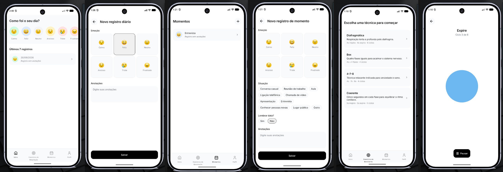

<h1 align="center">Pera</h1>

<p align="center">Acompanhamento emocional e respiração guiada para quem convive com disfluência de fala ou ansiedade social.</p>

<br />

<p align="center">
  
</p>

# Sobre

O Pera é um aplicativo mobile desenvolvido para ajudar pessoas com disfluência de fala ou ansiedade social a acompanharem a evolução e lidarem melhor com situações desafiadoras, como falar ao telefone, participar de entrevistas ou falar em público. Esses momentos geram ansiedade, e na hora de olhar para trás o que costuma pesar na memória é a dificuldade, não os registros em que a pessoa se saiu bem, mesmo quando estes são mais numerosos. Isso atrapalha perceber o ganho de tranquilidade e segurança ao longo do tempo.

O app junta isso num histórico concreto para consultar depois. Na aba Início fica o dia a dia: você registra emoção e anotações, acompanha os últimos registros e abre a lista completa. Em Momentos o registro é de uma situação específica, detalhando como se saiu e como se sentiu, com o tipo de cenário (reunião, entrevista, ligação e outras), opção de lembrar a data e campo para anotações. Tudo fica na nuvem, ligado à conta, com cadastro, login, verificação de e-mail e recuperação e alteração de senha.

Também há exercícios guiados de respiração (diafragmática, box, 4-7-8 e coerente) para ajudar no controle da ansiedade antes ou depois dessas situações, com animação, contagem de ciclos, pausa e feedback háptico.

# Ferramentas

- [Expo](https://expo.dev/) e [React Native](https://reactnative.dev/)
- [Expo Router](https://docs.expo.dev/router/introduction/)
- [TypeScript](https://www.typescriptlang.org/)
- [Supabase](https://supabase.com/docs) (Auth, Postgres e RLS)
- [TanStack Query](https://tanstack.com/query)
- [TanStack Form](https://tanstack.com/form) e [Zod](https://zod.dev/)
- [Shopify Restyle](https://shopify.github.io/restyle/)
- [React Native Reanimated](https://docs.swmansion.com/react-native-reanimated/)

# Rodando o projeto

Você precisa do [Node.js](https://nodejs.org/), [Git](https://git-scm.com/), [npm](https://docs.npmjs.com/), [Docker](https://docs.docker.com/get-docker/) (para o Supabase local) e, no celular, [Expo Go](https://expo.dev/client) ou um emulador. O projeto usa `expo-dev-client`; para build nativo, veja os scripts `android` e `ios` abaixo.

O backend versionado fica em `supabase/` (migrações + seed). Em desenvolvimento, a forma mais simples é subir o Supabase na máquina; detalhes e fluxo para manter o schema estão em [docs/SUPABASE.md](./docs/SUPABASE.md).

1. Clone o repositório:

```bash
git clone https://github.com/gabriellima2/pera.git
cd pera
```

2. Instale as dependências:

```bash
npm install
```

3. Suba o Supabase local (schema e situações):

```bash
npx supabase start
```

Na primeira execução isso aplica `supabase/migrations/` e `supabase/seed.sql`. Para recriar o banco do zero: `npx supabase db reset`.

4. Configure o `.env` ou `.env.local` (veja `.env.example`):

```bash
cp .env.example .env.local
```

Preencha `EXPO_PUBLIC_SUPABASE_PUBLISHABLE_KEY` com o valor **Publishable** de `npx supabase status`. A URL depende de onde o app roda (tudo na porta `54321`):

| Onde você testa                                     | `EXPO_PUBLIC_SUPABASE_URL`         |
| --------------------------------------------------- | ---------------------------------- |
| iOS Simulator ou na mesma máquina do Docker         | `http://127.0.0.1:54321`           |
| Emulador Android                                    | `http://10.0.2.2:54321`            |
| Celular físico (Expo Go / dev build) na mesma Wi‑Fi | `http://<IP-da-sua-máquina>:54321` |

Para projeto na nuvem, use URL e chave em **Settings → API** no painel Supabase.

5. Inicie o Expo:

```bash
npm run start
```

Escaneie o QR Code no terminal com o Expo Go ou pressione `a` / `i` para o emulador Android ou iOS.

**Scripts adicionais:**

```bash
npm run android   # build e execução nativa Android (dev client)
npm run ios       # build e execução nativa iOS (dev client)
npm run web       # versão web via Metro
npm run lint      # ESLint (Expo)
```

## Encerrar o desenvolvimento

1. Pare o bundler do Expo (`npm run start`, `npm run android`, etc.) com `Ctrl+C` no terminal onde o Metro está rodando.

2. Pare o Supabase local e os containers Docker do projeto:

```bash
npx supabase stop
```

Isso libera portas (`54321`, `54322`, Studio, Mailpit, etc.). Na próxima sessão, suba de novo com `npx supabase start` (os dados do banco local costumam persistir entre `stop` e `start`).

Para ver se ainda há algo rodando:

```bash
npx supabase status
```

Emulador ou simulador você fecha pela própria IDE ou pelo app do emulador; isso não encerra o Supabase na máquina.

Mais detalhes sobre backend e schema: [docs/SUPABASE.md](./docs/SUPABASE.md).

<h4 align="center">Projeto feito com 💙 por Gabriel Lima</h4>
